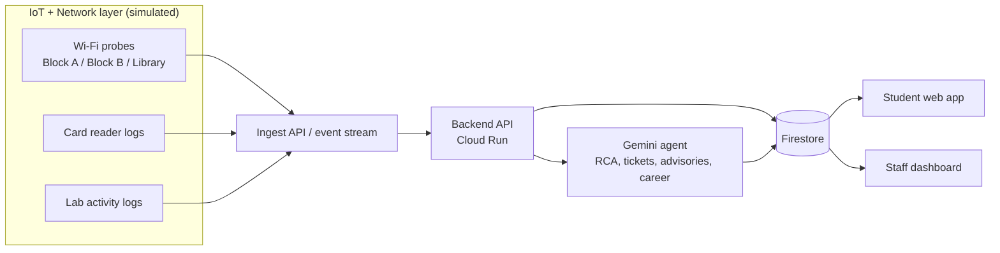

# Campus Lab Agent (working title)

**APU Cloud Innovation Hackathon 2026** · Track: *Intelligent Automation & Digital Transformation*

> An autonomous campus agent that turns Wi-Fi telemetry and lab card-reader logs into
> (1) live "where should I study right now?" guidance plus automatic IT tickets, and
> (2) career-path suggestions based on what students actually do in the labs.

**One data pipeline, two outputs.** Cloud + Network + IoT working together in a single loop.

---

## The problem

- Campus Wi-Fi degrades often. Everyone floods the staff Wi-Fi, and IT finds out late and diagnoses by hand.
- Students don't know which lab or library has free seats **and** a working network.
- Students get little data-driven guidance on which career direction fits their hands-on lab work.

## The solution

| Layer | What it does | How (prototype) |
|---|---|---|
| **IoT** | Card-reader logs: who enters or leaves which lab, so we know live occupancy | Simulated log generator |
| **Network** | Wi-Fi probe telemetry (latency, packet loss, RSSI, AP syslogs) plus lab activity (time spent, modules completed) | Python probes in Block A, Block B, Library |
| **Cloud** | Gemini analyses everything: root cause of failures, IT tickets, student advisories, career path suggestions | Gemini + Google Cloud |

**Ops side (AIOps):** detects Wi-Fi degradation or AP failure, finds the root cause (AP hardware vs ISP link), logs an IT ticket and posts a student advisory.

**Student side:** shows the best place to study right now (seats plus network quality). The career module turns lab activity into a career fit, recommended certs and a 6-month plan.

## Architecture



Full details: [docs/architecture.md](docs/architecture.md) · Data contract: [docs/event-schema.md](docs/event-schema.md)

## Demo flow (3 minutes)

1. Normal state: the student page shows all zones healthy with seat counts.
2. Click **"Kill AP in Block B"** (fault injection).
3. Probe metrics degrade, and the agent detects it and runs root-cause analysis.
4. IT ticket is created automatically and the staff dashboard lights up.
5. The student page updates: "Block B Wi-Fi degraded, try Lab 3 (12 seats free, stable Wi-Fi)".
6. Career panel: "Based on your lab hours, you fit SOC Analyst. Here is your 6-month plan."

## Team

| Member | Owns | Folder |
|---|---|---|
| **Htet Win** | AI agent: Gemini root-cause analysis, ticket and advisory generation | [`agent/`](agent/) |
| **Raja** | Simulators: Wi-Fi probes, card-reader logs, fault injection | [`simulator/`](simulator/) |
| **Pang Zai Yong** | Frontend: student page and staff dashboard | [`frontend/`](frontend/) |
| **Pang Zai Jie** | Career path module, plus pitch deck story | [`career/`](career/) |
| **Koguleswaraan** | Cloud setup, backend and integration, security, final submission | [`backend/`](backend/) |

Detailed tasks and timeline: [docs/team-plan.md](docs/team-plan.md)

## Tech stack (proposed, confirm after briefing notes)

- **Simulators / backend / agent:** Python (FastAPI)
- **Event stream:** Google Cloud Pub/Sub (or a plain ingest endpoint if time is short)
- **Hosting:** Cloud Run · **Database:** Firestore
- **AI:** Gemini via Vertex AI or the Gemini API
- **Frontend:** to be decided by Pang Zai Yong (keep it simple)

> Open question: the original idea mentioned *Google Antigravity* as the event pipeline. Confirm from the
> briefing what it is meant for. If unsure, we use Pub/Sub.

## Repo structure

```
.
├── README.md
├── CONTRIBUTING.md           # branch + pull request workflow
├── docs/                     # architecture, data contract, team plan, pitch outline
├── simulator/                # Raja: probes, card logs, fault injection
├── agent/                    # Win: Gemini agent logic and prompts
├── backend/                  # Koguleswaraan: API, cloud config, integration
├── frontend/                 # Pang Zai Yong: student page + staff dashboard
├── career/                   # Pang Zai Jie: career path module
└── .env.example              # copy to .env, never commit secrets
```

## Privacy and data

All data in this prototype is **simulated**. Student IDs are anonymised (hashed) in every event, and the
career module is an **opt-in suggestion**, not a judgement of the student.

## Key dates (MYT)

| Date | What |
|---|---|
| 8 Nov, 11:59 PM | Team registration closes (leader creates the team, all 5 members join) |
| **10 Nov, 11:59 PM** | **Prototype submission deadline** (aim to submit by the afternoon) |
| 11-14 Nov | Submission assessment |
| 15 Nov | Top 5 announced |
| 17 Nov | Top 5 final pitch, APU Auditorium (NexConnect '26) |

## Submission checklist

- [ ] Project title and track selected
- [ ] Summary (at least 50 characters)
- [ ] HTTPS repository link (check with organisers whether the repo must be public)
- [ ] PDF pitch deck (max 10 MB)
- [ ] Demo link (optional)
- [ ] Only the team leader can submit, and submission locks the project and PDF

## Status

Planning phase. Idea locked: Wi-Fi health core plus lab card-reader data plus career path module.
