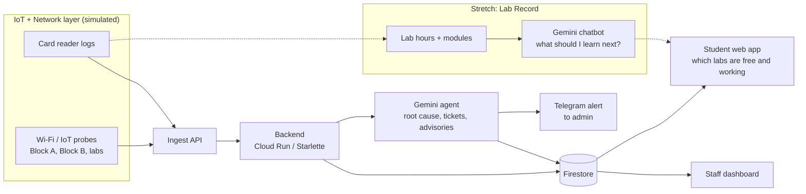

# Smart Lab Companion (working title)

**APU Cloud Innovation Hackathon 2026** · Track: *Intelligent Automation & Digital Transformation*

> From finding a working lab to knowing what to learn next, one companion for every student's lab journey.

An autonomous campus agent that watches Wi-Fi and IoT health across Block A, Block B and the labs, finds the
root cause when something fails, alerts the admin automatically, and tells students which labs are free and
working right now. A lab-record module (stretch goal) turns each student's lab hours into personalised
"what should I learn next?" guidance.

---

## Scope

| Priority | Feature | What it does |
|---|---|---|
| **Core (build first)** | **Campus Health** | Monitors Wi-Fi and IoT health per block and lab, finds the root cause of failures, opens an IT ticket, sends a Telegram alert to the admin, and shows students which labs are free and working. |
| **Stretch** | **Lab Record** | Uses card-reader lab hours and modules completed to power a Gemini chatbot: "what should I pursue next?", answered from the student's own data. |

**Rule:** Campus Health comes first and must work end to end. Lab Record is built only after the first
end-to-end run (**7 Nov**). If the chatbot isn't working by then, it becomes a "future roadmap" slide in the
pitch and not a feature.

## The problem

- Campus Wi-Fi and lab equipment fail often. Everyone floods the staff Wi-Fi, and IT finds out late and diagnoses by hand.
- Students can't tell which lab has free seats **and** a working network.
- Students get little data-driven guidance on what to learn next from their hands-on lab work.

## The solution

| Layer | What it does | How (prototype) |
|---|---|---|
| **IoT** | Card-reader logs: who enters or leaves which lab, so we know live occupancy. IoT device health per block. | Simulated log generator |
| **Network** | Wi-Fi probe telemetry (latency, packet loss, RSSI, AP syslogs) for Block A, Block B and the labs | Python probes |
| **Cloud** | Gemini analyses the logs: root cause, tickets, advisories, and (stretch) career guidance | Gemini + Google Cloud |

## Architecture



Full details: [docs/architecture.md](docs/architecture.md) · Data contract: [docs/event-schema.md](docs/event-schema.md)

## Demo story (3 minutes): one student, one journey

We follow one student, "Raja":

1. Raja wants to do the IoT lab. The app shows which labs are free and working.
2. We click **"Kill AP"** (fault injection). Probe metrics degrade and the agent finds the root cause.
3. An IT ticket is created automatically and the **admin gets a Telegram alert**.
4. The app updates and sends Raja to a healthy lab.
5. *(Stretch)* Weeks later Raja asks the chatbot "what should I pursue next?" and it answers from Raja's own lab hours.

Show results, not logs. The Campus Health part should take about 50 seconds of the pitch.

## Team

| Member | Owns | Folder |
|---|---|---|
| **Htet Win** | AI agent: Gemini root-cause analysis, ticket and advisory generation | [`agent/`](agent/) |
| **Raja** | Simulators: Wi-Fi/IoT probes, card-reader logs, fault injection | [`simulator/`](simulator/) |
| **Pang Zai Yong** | Frontend: student page and staff dashboard | [`frontend/`](frontend/) |
| **Pang Zai Jie** | Telegram admin alert, occupancy data, pitch deck. Stretch: Lab Record chatbot | [`career/`](career/) |
| **Koguleswaraan** | Cloud setup, backend and integration, security, final submission | [`backend/`](backend/) |

Detailed tasks and timeline: [docs/team-plan.md](docs/team-plan.md)

## Tech stack (proposed)

- **Simulators / backend / agent:** Python (backend on Starlette + uvicorn, see [backend/README.md](backend/README.md))
- **Event stream:** Google Cloud Pub/Sub, or a plain ingest endpoint if time is short
- **Hosting:** Cloud Run · **Database:** Firestore
- **AI:** Gemini via Vertex AI or the Gemini API
- **Admin alerts:** Telegram Bot API
- **Frontend:** to be decided by Pang Zai Yong (keep it simple)

## Repo structure

```
.
├── README.md
├── CONTRIBUTING.md           # branch + pull request workflow
├── docs/                     # architecture, data contract, team plan, pitch outline
├── simulator/                # Raja: probes, card logs, fault injection
├── agent/                    # Win: Gemini agent logic and prompts
├── backend/                  # Koguleswaraan: API, cloud config, integration
├── frontend/                 # Pang Zai Yong: student page + staff dashboard
├── career/                   # Pang Zai Jie: Telegram alert, lab record (stretch)
└── .env.example              # copy to .env, never commit secrets
```

## Privacy and data

All data in this prototype is **simulated**. Student IDs are anonymised (hashed) in every event, and the
Lab Record chatbot is an **opt-in suggestion**, not a judgement of the student.

## Key dates (MYT)

| Date | What |
|---|---|
| **7 Nov** | First end-to-end run. Decide whether Lab Record stays in. |
| 8 Nov, 11:59 PM | Team registration closes (leader creates the team, all 5 members join) |
| **10 Nov, 11:59 PM** | **Prototype submission deadline** (aim to submit by the afternoon) |
| 11-14 Nov | Submission assessment |
| 15 Nov | Top 5 announced |
| 17 Nov | Top 5 final pitch, APU Auditorium (NexConnect '26) |

## Submission checklist

- [ ] Project title and track selected
- [ ] Summary (at least 50 characters)
- [ ] HTTPS repository link (check with organisers whether the repo must be public)
- [ ] PDF pitch deck (max 10 MB)
- [ ] Demo link (optional)
- [ ] Only the team leader can submit, and submission locks the project and PDF

## Status

Build phase. Core scope: Campus Health. Stretch: Lab Record chatbot. Checkpoint: 7 Nov.
