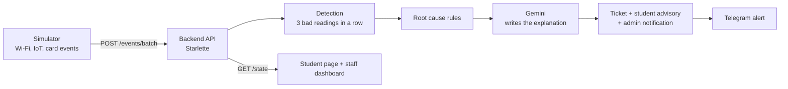

# Smart Lab Companion (working title)

**APU Cloud Innovation Hackathon 2026** · Track: *Intelligent Automation & Digital Transformation*

> From finding a working lab to knowing what to learn next, one companion for every student's lab journey.

An autonomous campus agent that watches Wi-Fi and IoT health across Block A, Block B and the labs, finds the
root cause when something fails, alerts the admin automatically, and tells students which labs are free and
working right now. All data in this prototype is simulated.

## What it does

| | |
|---|---|
| **Campus Health** (core) | Monitors Wi-Fi and IoT health per block and lab, finds the root cause of a failure, opens an IT ticket, sends an admin alert on Telegram, and works out which labs are free and working. |
| **Lab Record** (stretch) | Lab hours and modules per anonymised student feed a Gemini chatbot, "what should I pursue next?". Lab activity events are stored; the chatbot is not built yet. |

## How it works



Root causes: `ap_hardware_failure`, `isp_uplink_outage` (campus-wide), `congestion`, `iot_device_fault`.
Rules decide the cause; Gemini only writes the explanation and recommended action, with a template as fallback.
More detail: [docs/architecture.md](docs/architecture.md) · Data contract: [docs/event-schema.md](docs/event-schema.md)

## Run it

```bash
# 1. backend (terminal 1)
cd backend
pip install -r requirements.txt
cp ../.env.example .env        # optional: add your own GEMINI_API_KEY (free key from Google AI Studio)
uvicorn app.main:app --port 8000

# 2. frontend (terminal 2)
cd frontend
npm install
npm run dev                    # opens http://localhost:5173

# 3. simulator (terminal 3, from the repo root)
python simulator/run.py --demo
```

Frontend details: [frontend/README.md](frontend/README.md) · Backend details: [backend/README.md](backend/README.md) · Simulator: [simulator/README.md](simulator/README.md)

## Demo story

We follow one student, "Raja":

1. Raja wants to do the IoT lab. The app shows which labs are free and working.
2. We inject a fault ("kill an AP"). The agent finds the root cause.
3. An IT ticket is created and the admin gets a Telegram alert.
4. The app updates and sends Raja to a healthy lab.

## Team

| Member | Owns |
|---|---|
| **Htet Win** | AI agent: root-cause analysis with Gemini |
| **Raja** | Simulator: Wi-Fi/IoT probes, card events, fault injection |
| **Pang Zai Yong** | Frontend: student page and staff dashboard |
| **Pang Zai Jie** | Telegram admin alert, occupancy, pitch deck |
| **Koguleswaraan** | Backend, cloud, security, Testing |

## Repo structure

```
.
├── backend/        API, detection, tickets, advisories, security (57 tests)
├── simulator/      simulated campus data and fault injection (12 tests)
├── frontend/       student companion, staff dashboard, demo controller
├── docs/           architecture, data contract, pitch outline
├── CONTRIBUTING.md branch and pull request workflow
└── .env.example    copy to .env, never commit secrets
```

New folders (agent, frontend, Telegram) are added by their owners in their own pull requests.

## Privacy and security

- Simulated data only. Students appear only as a hashed id (`student_hash`); events that carry raw identifiers are rejected.
- Writes and reads are protected by API keys; in production the server refuses to start without them.
- Secrets live in `.env` (git-ignored), never in the repo.
