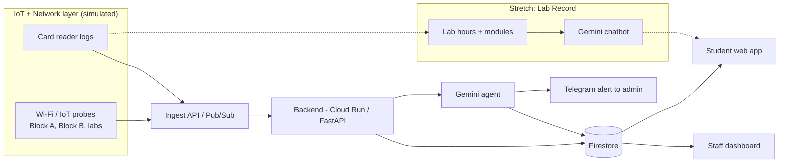

# Architecture

## Overview

One data pipeline. The **core** is Campus Health. **Lab Record** is a stretch module that reads the same card-reader data. Everything at the edge is simulated, so the prototype needs no hardware.

## Components

| Component | Owner | Responsibility |
|---|---|---|
| `simulator/` | Raja | Generates Wi-Fi/IoT telemetry and card events. Has a fault-injection command for the demo. |
| `backend/` | Koguleswaraan | Ingest endpoint, storage, `zone_status`, wiring, Cloud Run, auth and secrets. |
| `agent/` | Htet Win | Detects anomalies, root-cause analysis with Gemini, generates tickets, advisories and notifications. |
| `career/` | Pang Zai Jie | Telegram `send_alert`, occupancy from card events, pitch. Stretch: Lab Record chatbot. |
| `frontend/` | Pang Zai Yong | Student page (which labs are free and working) and staff dashboard. Stretch: chatbot panel. |

## Flows

### 1. Campus Health loop (core)
1. Probes send `wifi_telemetry` and `iot_health` events every few seconds.
2. Backend stores them and checks thresholds (latency, packet loss, RSSI, device status).
3. On a breach, the agent gets recent events from nearby APs and decides: **AP hardware failure**, **ISP / uplink outage**, **congestion** or **IoT device fault**. One AP bad while neighbours are fine means hardware; many APs bad together means uplink.
4. The agent writes a `ticket`, a student `advisory` and a `notification`.
5. The Telegram sender delivers the `notification` to the admin.
6. The dashboard and student page update.

### 2. Which labs are free and working (core)
1. `card_access` events update seats free per location.
2. Seats free are combined with Wi-Fi/IoT health into a `zone_status` for each lab and block.
3. The student page ranks them and shows the best lab right now, and why.

### 3. Lab Record chatbot (stretch)
1. `lab_activity` events are aggregated per anonymised student (hours per lab, modules completed).
2. Gemini answers "what should I pursue next?" using only that student's data.
3. Rule: if a lab had an outage ticket, minutes spent elsewhere in that window are flagged as unreliable.
4. Shown as an opt-in suggestion.

## Cloud services (proposed)

- Cloud Run (backend + agent), Firestore (state), Pub/Sub (optional event stream), Gemini via Vertex AI or the Gemini API, Telegram Bot API for alerts.
- Keep it simple. If a service slows us down, fall back to plain HTTP endpoints plus Firestore.

## Security and privacy

- Simulated data only. Student identifiers are hashed (`student_hash`).
- Secrets (Gemini key, Telegram token) in environment variables, never in git.
- Career guidance is a suggestion with an opt-in screen.
