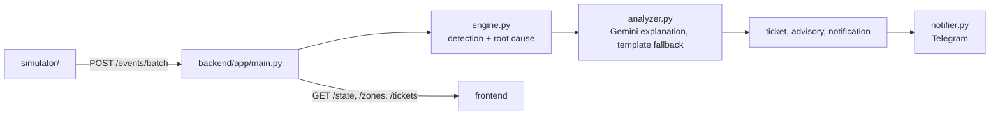

# Architecture

What is built today. Everything at the edge is simulated, so the prototype needs no hardware or cloud account.

## Components

| Component | Where | Responsibility |
|---|---|---|
| Simulator | `simulator/` | Generates Wi-Fi, IoT and card events every tick. Fault commands for the demo (kill an AP, degrade a block, lab down, congestion, IoT fault, uplink outage). |
| Backend API | `backend/app/main.py` | Ingest endpoints, read endpoints for the frontend, API-key checks, CORS. |
| Detection and root cause | `backend/app/engine.py` | Trips a flag after 3 bad readings in a row, classifies the cause, opens, merges and auto-resolves tickets. |
| Explanation | `backend/app/analyzer.py`, `llm.py` | Gemini writes the explanation and recommended action. Retries once on overload, falls back to a second model, then to a template. |
| Lab status | `backend/app/health.py` | Seats free (from card events) plus Wi-Fi/IoT health gives a score per location, and the best lab right now. |
| Alerts | `backend/app/notifier.py` | Telegram delivery. Shows `sent=false` and the error if Telegram is not configured. |
| Privacy and security | `privacy.py`, `security.py` | Hashed student ids, rejection of raw identifiers, API keys. |

## Flow

1. The simulator sends one batch per tick to `POST /events/batch`.
2. The backend applies the whole batch, then classifies once, so a campus-wide outage becomes one ticket and one alert.
3. Root cause rules:
   - many APs bad at once across 2+ locations → `isp_uplink_outage` (campus-wide, replaces per-AP tickets)
   - bad APs with many clients, low loss and good signal → `congestion`
   - other bad APs → `ap_hardware_failure`
   - an IoT device reporting `down` → `iot_device_fault`
4. Gemini writes the explanation. The ticket, a student advisory (pointing to the best healthy lab with free seats) and an admin notification are created, and Telegram delivers the alert.
5. When readings are normal for 3 readings in a row, the ticket auto-resolves and a recovery advisory is posted.
6. The frontend reads everything from `GET /state`.

## Storage

State is held in memory in one backend instance (`backend/app/store.py`). It resets when the server restarts.

## Security and privacy

- Simulated data only. Students are identified only by `student_hash`.
- `X-API-Key` protects writes (`INGEST_API_KEY`) and reads (`DASHBOARD_API_KEY`). With `APP_ENV=production` the server will not start without both.
- Secrets (Gemini key, Telegram token) are environment variables or `.env`, never in git.
