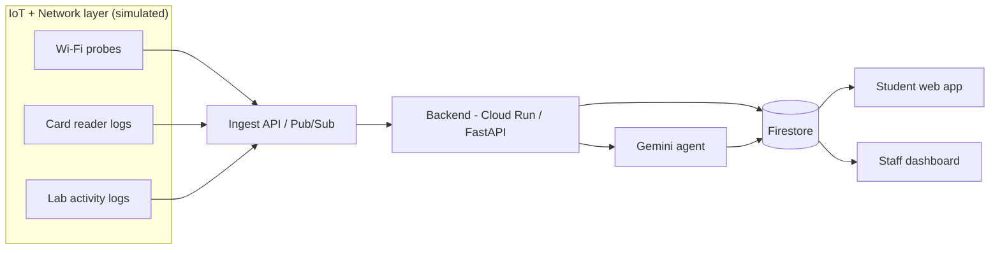

# Architecture

## Overview

One data pipeline feeds two outputs. Everything at the edge is simulated, so the prototype needs no hardware.

## Components

| Component | Owner | Responsibility |
|---|---|---|
| `simulator/` | Raja | Generates telemetry, card events and lab activity. Has a fault-injection command for the demo. |
| `backend/` | Koguleswaraan | Ingest endpoint, storage, wiring the agent, Cloud Run deployment, auth and secrets. |
| `agent/` | Htet Win | Detects anomalies, root-cause analysis with Gemini, generates tickets and advisories. |
| `career/` | Pang Zai Jie | Aggregates lab hours per student and asks Gemini for a career fit plus 6-month plan. |
| `frontend/` | Pang Zai Yong | Student "where to study now" page and staff dashboard with tickets. |

## Flows

### 1. Ops loop (AIOps)
1. Probes send `wifi_telemetry` events every few seconds.
2. Backend stores them and checks thresholds (latency, packet loss, RSSI).
3. On a breach, the agent gets the recent events from nearby APs and decides: **AP hardware failure** or **ISP / uplink outage** (many APs affected at once means uplink; a single AP means hardware).
4. The agent writes a `ticket` and a student `advisory`.
5. The dashboard and student page update.

### 2. Study zone
1. `card_access` events update seat occupancy per location.
2. Occupancy is combined with Wi-Fi health into a `zone_status` per location.
3. The student page ranks zones and shows the best one (and why).

### 3. Career path
1. `lab_activity` events are aggregated per anonymised student (hours per lab type, modules completed).
2. Gemini maps that to career fit, recommended certs and skills, and a 6-month plan.
3. The output is a `career_suggestion` shown to the student as an opt-in suggestion.

## Cloud services (proposed)

- Cloud Run (backend + agent), Firestore (state), Pub/Sub (optional event stream), Gemini via Vertex AI or the Gemini API.
- Keep it simple. If a service slows us down, fall back to plain HTTP endpoints plus Firestore.

## Security and privacy

- Simulated data only. Student identifiers are hashed (`student_hash`).
- Secrets in environment variables, never in git.
- Career output is a suggestion, with an opt-in screen in the UI.
